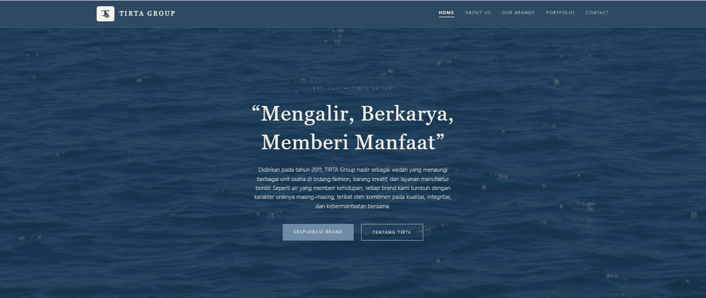
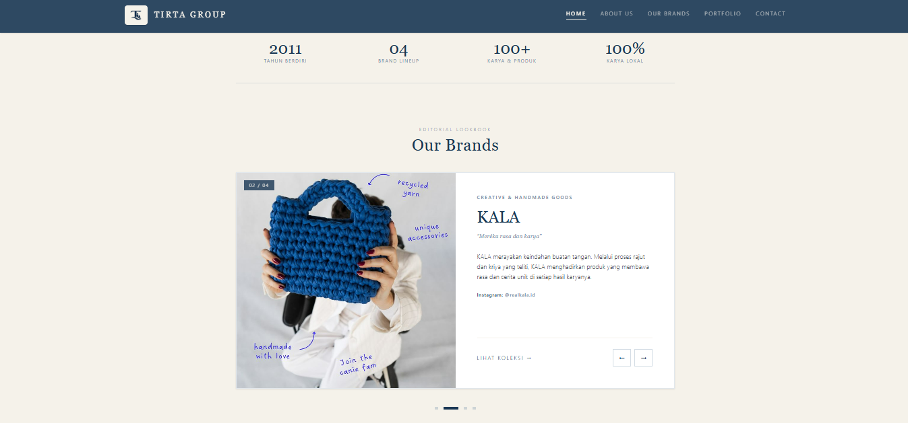
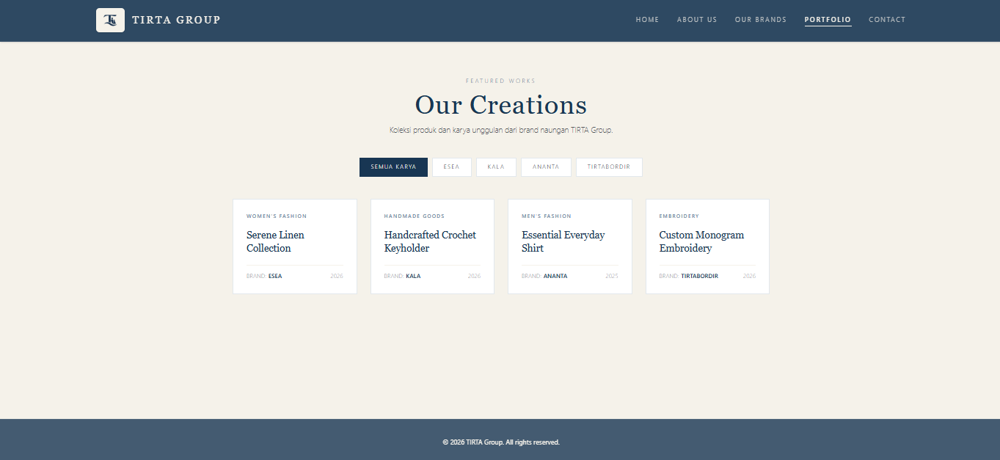
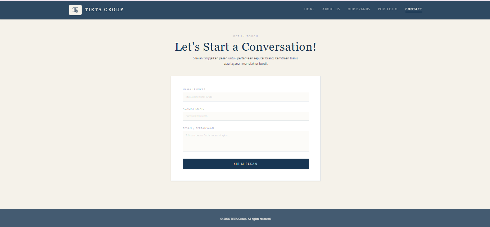

# Company Profile: TIRTA Group

**Nama:** Amelia Ananda Tirtaputri  
**NIM:** 2510502  
**Kelas:** Pendidikan Ilmu Komputer - 3C

## Deskripsi

Website company profile untuk **TIRTA Group (Est. 2011)**, sebuah perusahaan yang menaungi empat lini usaha di bidang fashion, barang kreatif/kriya, dan layanan bordir, yaitu ESEA, KALA, ANANTA, dan TIRTABORDIR.

Website ini dikembangkan menggunakan **React (Vite), Tailwind CSS, dan React Router DOM** dengan konsep desain *editorial minimalis*. Website terdiri dari lima halaman utama: Beranda, Tentang Kami, Brand Kami, Portofolio, dan Kontak. Tampilan dirancang responsif agar dapat digunakan pada perangkat desktop maupun mobile.

### Fitur Utama

- Komponen yang dapat digunakan kembali, seperti Navbar, Footer, dan Card.
- Data brand dan portofolio disimpan dalam file JavaScript dan ditampilkan menggunakan metode `.map()`.
- Lookbook carousel interaktif pada halaman Beranda.
- Filter kategori pada halaman Portofolio.
- Formulir kontak dengan validasi sederhana untuk nama, email, dan pesan.

## Cara Menjalankan

Pastikan Node.js sudah terpasang pada perangkat.

```bash
npm install
npm run dev
```

Untuk membuat build produksi, jalankan:

```bash
npm run build
```

## Screenshot

### Beranda





### Tentang Kami


### Our Brands


### Portofolio



### Kontak


